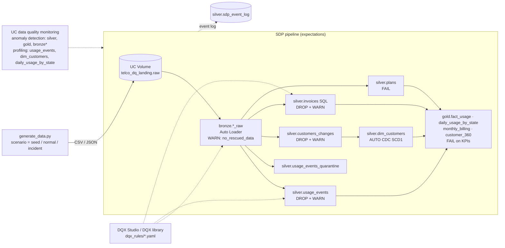

# Telco — Data Quality on Databricks: 3 approaches, 1 dataset

This is a Databricks Asset Bundle (DAB) for an end-to-end demo of the three data quality capabilities on the Databricks Platform, all running against the same mock **telco** dataset:

| # | Approach | Question it answers | Where it lives |
|---|---|---|---|
| 1 | **Unity Catalog data quality monitoring** (anomaly detection + data profiling) | *"Is my data healthy right now, and is it drifting?"* | Catalog Explorer (UC), no code |
| 2 | **Spark Declarative Pipelines (SDP) expectations** | *"Should this record go into the table?"* | Inside the pipeline code (Python or SQL) |
| 3 | **DQX + DQX Studio** (Databricks Labs) | *"Does this table follow our business rules? Who approved those rules?"* | Databricks App (UI) + DQX library (code) |

The step-by-step demo script is in **[docs/DEMO_GUIDE.md](docs/DEMO_GUIDE.md)**.

---

## 1. Why three approaches? (the short version)

They are complementary layers, not competitors:

```
          prevent                         validate                          observe
   ┌──────────────────────┐   ┌────────────────────────────────┐   ┌──────────────────────────────┐
   │ SDP Expectations     │   │ DQX / DQX Studio               │   │ UC Data Quality Monitoring   │
   │ in-flight, per row   │   │ rule catalog, any table,       │   │ anomaly detection on whole   │
   │ warn / drop / fail   │   │ row + dataset + cross-table    │   │ schemas + statistical        │
   │ while data is written│   │ checks, quarantine, approvals  │   │ profiling & drift per table  │
   └──────────────────────┘   └────────────────────────────────┘   └──────────────────────────────┘
      "known rules,             "known rules, owned by the           "unknown unknowns:
       owned by the DE"          business / data stewards"             late, missing, drifting"
```

- **Expectations** stop bad records at the door of a pipeline. They are code, versioned with the pipeline, and cost almost nothing extra to run.
- **DQX** covers the rules expectations can't express: uniqueness, referential integrity, cross-table reconciliation, aggregate thresholds, freshness. It also covers tables you **don't own the pipeline for** (vendor loads, Lakeflow Connect, partner shares, legacy jobs). With **DQX Studio**, data stewards can write, approve, schedule and review those rules without touching code.
- **UC data quality monitoring** catches what nobody wrote a rule for. A table stops updating (freshness), volume collapses (completeness), or a column's distribution drifts (profiling). You turn it on with a toggle, at schema scale.

## 2. Detailed comparison

| | 1. UC data quality monitoring | 2. SDP expectations | 3. DQX / DQX Studio |
|---|---|---|---|
| **Type** | Observability (statistical / ML) | Declarative constraints | Rule engine + rule management app |
| **Product status** | Native UC feature. Anomaly detection is Public Preview; data profiling is GA (formerly *Lakehouse Monitoring*) | Native, GA, part of Lakeflow SDP | Databricks Labs open source ([databrickslabs/dqx](https://github.com/databrickslabs/dqx)); Studio is deployed as a Databricks App |
| **Setup** | Toggle in Catalog Explorer (schema → *Details* → *Data Quality Monitoring*) or API | `@dp.expect*` decorators / `CONSTRAINT ... EXPECT` in SQL | YAML/JSON rules or UI forms; profiler suggests rules |
| **Scope** | Whole schema (anomaly detection) or one table (profiling) | Datasets of the pipeline | Any UC table or view, any DataFrame (batch or streaming) |
| **Rules needed?** | No. Learns from history | Yes, written by the data engineer | Yes, but the profiler bootstraps them |
| **When it runs** | After data lands (periodic scans / scheduled refresh) | While data is written (in-flight) | In a pipeline/job (code) or on a schedule/on demand (Studio) |
| **What it checks** | Freshness, completeness (row volume); null %, distinct counts, min/max/stats, distribution drift, custom metrics | Any boolean SQL expression **per row** | Row checks (null, regex, range, list, email, dates…), **dataset checks** (unique, foreign key, aggregates, freshness, schema), **cross-table SQL** |
| **Action on failure** | Flags the table (health indicator), result rows in system table, drives alerts | `WARN` (keep + count) · `DROP` (filter) · `FAIL` (stop the update) | `error` / `warn` criticality; split into valid + quarantine; `_errors` / `_warnings` columns explain each row |
| **Bad-row visibility** | No (aggregate level) | Counts only (quarantine is a DIY pattern, shown in this demo) | Yes, every failed row with reasons |
| **Where results go** | `system.data_quality_monitoring.table_results`, `*_profile_metrics` / `*_drift_metrics` tables, auto-generated AI/BI dashboard | Pipeline UI + event log (`flow_progress.data_quality`) | Quarantine tables, `dq_metrics`, `dq_validation_runs`, embedded AI/BI dashboard |
| **Who uses it** | Platform team, data owners, consumers (health badges) | Data engineers | Data stewards, business analysts, DEs (rules as code in CI/CD) |
| **Governance** | UC permissions (`MANAGE` on schema) | Pipeline code review | RBAC (author → approver), rule history/audit, comments, review status |
| **Cost** | Serverless DBUs per scan/refresh | Only the pipeline compute | Serverless job compute per run + small app/Lakebase footprint |
| **Main limitation** | Doesn't tell you *which* rows are bad; needs history to learn patterns | Only row-level; only inside SDP pipelines | One more component to deploy and operate (Labs project) |

### When to use what, on the telco data

| Situation in the demo dataset | Best fit |
|---|---|
| CDR with negative duration, invalid MSISDN, future timestamp, unknown event type | **SDP expectation (DROP)** in silver. Never let it reach billing/BI |
| Missing `cell_id` / `device_type` (incomplete but still useful record) | **SDP expectation (WARN)** + **profiling** to watch the null % trend |
| Corrupted plan catalog (reference data) | **SDP expectation (FAIL)**. Stop the pipeline, a human must look |
| Duplicate `event_id` from a mediation retry; CDR for a customer missing from the CRM | **DQX** `is_unique`, `foreign_key` (expectations can't express these) |
| Invoice amount below the plan's monthly fee (cross-table business rule) | **DQX** `sql_query` check, authored and approved by billing stewards in **DQX Studio** |
| Raw CRM extract you don't control (CPF format, e-mail, UF, minors) | **DQX Studio** on `bronze.customers_raw`: profile → rules → schedule |
| Billing feed silently stops arriving | **Anomaly detection, freshness** |
| Usage volume drops 95% after a mediation outage | **Anomaly detection, completeness** |
| Null rate of `cell_id` jumps from 1% to 60% after a network release | **Data profiling** drift (and DQX `cell_id_present` warn rule) |

---

## 3. The mock dataset

Mock data for a Brazilian telco. A generator notebook writes raw files into a UC volume, the same way upstream systems drop extracts:

| Entity | Source system it mimics | Format | Volume (seed) |
|---|---|---|---|
| `plans` | Product catalog (Pré, Controle, Pós) | CSV | 8 |
| `customers` | CRM: new customers + updates | CSV | 2,000 + ~40/hour |
| `usage_events` | Mediation: voice/SMS/data CDRs | JSON lines | ~220k (30 days) + 300/hour |
| `invoices` | Billing | JSON lines | ~12k (6 months) + ~10/hour |

About **3% of rows carry realistic defects**: invalid CPF/e-mail/UF, minors, unknown segment, negative durations and charges, truncated MSISDNs, future timestamps, unknown event types, duplicate event IDs, orphan customers, invoices with due date before issue date, invalid status, and so on.

### Architecture



### Schemas (in the catalog set by the `catalog` variable)

| Schema | Content |
|---|---|
| `telco_dq_landing` | Volume `raw/` with the landed files |
| `telco_dq_bronze` | `plans_raw`, `customers_raw`, `usage_events_raw`, `invoices_raw` |
| `telco_dq_silver` | `plans`, `customers_changes`, `dim_customers`, `usage_events`, `usage_events_quarantine`, `invoices`, `sdp_event_log`, and the `*_dqx_valid` / `*_dqx_quarantine` tables from the DQX-as-code job |
| `telco_dq_gold` | `fact_usage`, `daily_usage_by_state`, `monthly_billing`, `customer_360` |
| `telco_dq_monitoring` | Data profiling output (`*_profile_metrics`, `*_drift_metrics`) |

### Incident scenarios (job parameter `scenario` of *Telco DQ - 2. Hourly ingest*)

| `scenario` / parameter | What happens | Caught by |
|---|---|---|
| `normal` | One hour of data, ~3% defects | — |
| `bad_data_burst` | ~30% defective rows | SDP drop counts spike; DQX error rate |
| `null_spike` | 60% of `cell_id` / `device_type` null (WARN only, so it reaches silver) | Data profiling null % drift; DQX warn |
| `volume_drop` | 5% of the normal volume | Anomaly detection, completeness |
| `schema_drift` | Upstream renames `charge_brl` → `charge_amount` and adds `network_tech` | Bronze `no_rescued_data` WARN; silver `non_negative_charge` DROP |
| `skip_entities=invoices` | Billing feed stops arriving | Anomaly detection, freshness |
| `refresh_profiles=true` | Refreshes the data profiles after the pipeline | — |

---

## 4. Repository layout

```
databricks.yml                     bundle + variables (catalog, schemas, DQX Studio SPs, schedule)
resources/
  schemas.yml                      UC schemas, landing volume, SELECT grants for DQX Studio SPs
  pipeline.yml                     SDP pipeline (serverless, event log published to UC)
  jobs.yml                         1. Bootstrap job · 2. Hourly ingest job (incident scenarios)
src/
  data_generator/generate_data.py  mock telco data + defect/incident injection
  pipeline/01_bronze.py            Auto Loader, explicit schema, rescued data
  pipeline/02_silver.py            Python expectations: warn / drop / fail, quarantine, AUTO CDC
  pipeline/03_silver_invoices.sql  SQL expectations (CONSTRAINT ... EXPECT ... ON VIOLATION)
  pipeline/04_gold.sql             gold MVs with FAIL on KPIs + referential WARN
  monitoring/enable_quality_monitoring.py   enables anomaly detection + data profiles (warm-up)
  monitoring/refresh_profiles.py            refreshes all profiles
  monitoring/sdp_expectations_report.sql    expectation metrics from the event log
  dqx/dqx_as_code.py                        applies dqx_rules/*.yaml with the DQX library
dqx_rules/                         DQX rules (YAML), ready to paste in DQX Studio
  customers.yaml · usage_events.yaml · invoices.yaml
docs/DEMO_GUIDE.md                 step-by-step demo script
```

## 5. Deploy

Prerequisites: Databricks CLI ≥ 0.250, a CLI profile for the workspace, `USE CATALOG` + `CREATE SCHEMA` on the catalog, serverless enabled, and DQX Studio already deployed (its service principals already have `USE CATALOG` on the catalog).

```bash
cp targets.local.yml.example targets.local.yml    # set profile, catalog and DQX Studio SP IDs
databricks auth login --profile <profile>
databricks bundle validate
databricks bundle deploy
databricks bundle run telco_dq_bootstrap          # ~15 min: seed, full refresh, monitoring, DQX-as-code
```

The hourly ingest job is deployed **UNPAUSED** so anomaly detection can learn the commit pattern. Deploy with it on **at least a few hours (ideally a day) before the demo**:

```bash
databricks bundle deploy --var ingest_schedule_status=UNPAUSED   # warm-up
databricks bundle deploy --var ingest_schedule_status=PAUSED     # after the demo, to save cost
```

Environment settings live in `targets.local.yml` (git-ignored, copy it from `targets.local.yml.example`): CLI profile, `catalog`, `dqx_app_sp` (DQX Studio app service principal application ID) and `dqx_job_sp` (`run_as` of the DQX Studio task-runner job). The rule files in `dqx_rules/` use a `<catalog>` placeholder (for `ref_table` and `sql_query`): replace it before pasting into DQX Studio. `dqx_as_code.py` does it automatically.

## 6. Clean up

```bash
databricks bundle destroy        # drops the pipeline, jobs, schemas (and their tables) and the volume
```

Data profiles and anomaly detection are removed along with the tables and schemas. DQX Studio rules live in the app (Lakebase), so delete them from the Studio UI.

## 7. References

- UC data quality monitoring: [anomaly detection](https://docs.databricks.com/aws/en/data-governance/unity-catalog/data-quality-monitoring/anomaly-detection), [data profiling](https://docs.databricks.com/aws/en/data-governance/unity-catalog/data-quality-monitoring/data-profiling/)
- [SDP expectations](https://docs.databricks.com/aws/en/ldp/expectations)
- [DQX documentation](https://databrickslabs.github.io/dqx/) · [GitHub](https://github.com/databrickslabs/dqx)
